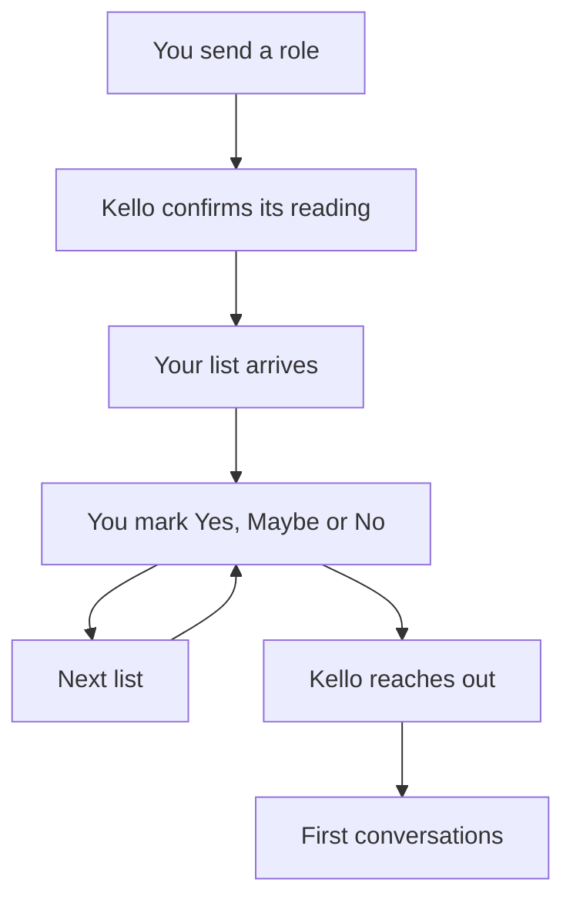

Kello works in one loop: you send a role, Kello sends up to 20 people in about two hours, you mark each one Yes, Maybe or No, and Kello reaches out to the people you approve. Most roles have candidates ready to interview within 7 days.

Each list teaches Kello more about what your team wants, so the next one is sharper. Kello works over email and your list page; it can't join calls.

## What are the steps?

<Steps>
  <Step title="Send your role">
    <Badge color="purple" icon="clock">A few minutes of your time</Badge>

    Email the <Tooltip tip="Job description: the document that describes the role.">JD</Tooltip> to [source@kello.ai](mailto:source@kello.ai) from your work email. One role per email.

    The first email works best with:

    - **Location, budget and work setup** (on-site, hybrid or remote). These are the details Kello most often has to ask for.
    - Must-haves vs nice-to-haves.
    - Companies to target or avoid.
    - A few LinkedIn profiles of people you'd hire.

    See [write a great brief](/kello/write-a-great-brief#what-should-a-brief-include).
  </Step>
  <Step title="Kello confirms how it read the role">
    <Badge color="purple" icon="clock">Within minutes</Badge>

    Kello replies with its reading of the role so you can correct it early. If something important is missing, it asks one short question. A one-line reply is enough.
  </Step>
  <Step title="Your first list arrives">
    <Badge color="purple" icon="clock">About two hours, usually within a few hours</Badge>

    A link to your Kello list page with up to 20 people. Each has a highlight, why this candidate fits your role, and one thing <Tooltip tip="The one thing on each candidate Kello suggests you confirm." cta="See the list page" href="/kello/your-list#what-does-each-candidate-show">worth checking</Tooltip>. The page also explains how Kello approached the search.
  </Step>
  <Step title="Mark Yes, Maybe or No">
    <Badge color="purple" icon="clock">Whenever you're ready</Badge>

    Mark each person and add a note on why if you like. Share the link with your hiring manager. Anyone with the link can review and mark.
  </Step>
  <Step title="Start outreach">
    <Badge color="purple" icon="clock">One short reply</Badge>

    Kello asks if you'd like it to reach out, with a few quick questions. You can also email Kello any time to start outreach. One short reply covers what Kello needs to know:

    - What should happen when a candidate is interested <Badge color="blue">Required</Badge>
    - Requirements every candidate must meet <Badge color="blue">Required</Badge>
    - Anyone not to contact <Badge color="blue">Required</Badge>
    - Your pitch <Badge color="gray">Optional</Badge>
    - Whether the salary range can be shared <Badge color="gray">Optional</Badge>
  </Step>
  <Step title="Kello reaches out">
    <Badge color="purple" icon="clock">Starts once you've answered the outreach questions</Badge>

    A named person from the Kello team contacts everyone you marked Yes, then everyone you marked Maybe. Never anyone marked No. Must-haves are checked in the conversation, so only people who fit come to you.
  </Step>
  <Step title="First conversations">
    <Badge color="purple" icon="clock">Within 7 days for most roles</Badge>

    Interested candidates book time on your calendar link, or Kello introduces them by email to the person taking the hire forward.
  </Step>
  <Step title="Next lists">
    <Badge color="purple" icon="clock">Usually within a few hours of your feedback</Badge>

    Your marks, notes and interview feedback shape the next list. Every new list has only new people.
  </Step>
  <Step title="Reference checks">
    <Badge color="purple" icon="clock">When you're close to a decision</Badge>

    For each candidate, Kello tells you who to speak to, what to ask, and shares their contact details. You make the calls.
  </Step>
</Steps>

## How long does each stage take?

### Timing

| Stage | Typical timing |
|---|---|
| Kello confirms how it read the role | Within minutes |
| First list | About two hours, usually within a few hours |
| Candidates ready to interview | Within 7 days for most roles |
| Next list after feedback | Usually within a few hours |
| Weekends | Kello works weekends |

### Limits per role

| Limit | Per role |
|---|---|
| People per list | Up to 20 |
| Lists per role | Up to 5 |
| Time window per role | 3 months from your first list |
| Still hiring after 3 months | Renew the role |

## What if Kello misread the role?

Reply with the correction in plain words, like `it's a Director role` or `Pune, not Bangalore`. Kello restarts on the corrected brief, even mid-search.

## What if the list is short?

Kello sends fewer than 20 people when not enough meet the bar, and tells you which requirement is narrowing the search. You never get an empty list. See [why a list is short](/kello/your-list#why-are-there-fewer-than-20-people).

## Related

<CardGroup cols={2}>
  <Card title="Quickstart" icon="play" href="/kello/quickstart" horizontal>
    Send your first role.
  </Card>
  <Card title="Your list" icon="list" href="/kello/your-list" horizontal>
    What each part of the list page tells you.
  </Card>
  <Card title="Feedback and next lists" icon="comments" href="/kello/feedback" horizontal>
    How Yes, Maybe, No and notes shape the next list.
  </Card>
  <Card title="Outreach" icon="paper-plane" href="/kello/outreach" horizontal>
    How Kello reaches out on your behalf.
  </Card>
</CardGroup>

Send your next role to [source@kello.ai](mailto:source@kello.ai).
